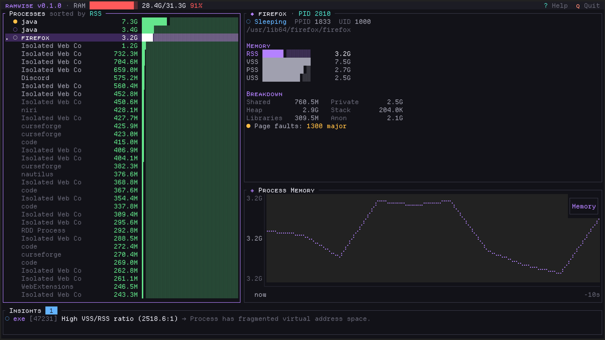
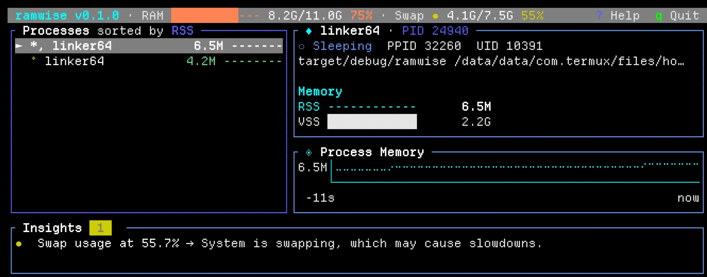

# ramwise

> Your memory's wise advisor - Intelligent RAM usage visualizer for Linux


**ramwise** is a terminal-based RAM usage visualizer that goes beyond basic memory monitoring. It provides deep memory introspection, intelligent leak detection, and beautiful visualization all in a lightweight TUI application.

## Features

- **Deep Memory Introspection** - See RSS, PSS, USS, shared/private breakdown per process
- **Intelligent Insights** - Rule-based analysis detects memory leaks, hogs, and anomalies
- **Beautiful TUI** - Modern interface with graphs, colors, and intuitive navigation
- **Minimal Footprint** - Written in Rust for maximum efficiency
- **Real-time Updates** - Live monitoring with configurable refresh rate
- **Process Control** - Stop (`SIGTERM`) or kill (`SIGKILL`) selected processes directly from the TUI

### Snapshot exports

The collector exposes a versioned `ExportSnapshot` contract for integrations and
future export formats. It uses wall-clock Unix milliseconds, explicit byte/count
units, collector metadata, and capability markers. Runtime-only monotonic
`Instant` values are intentionally not serialized; unavailable features remain
explicit in the exported capability map.

## Screenshots




## Installation

### From a binary

**Arch**

The package is available on the aur.

**Opensuse**

Download the .rpm from Releases and run `sudo zypper in filename.rpm`

**Fedora**

Download the .rpm from Releases and run `sudo dnf install filename.rpm` (untested)

### From Source

```bash
# Clone the repository
git clone https://github.com/Duckaet/ramwise
cd ramwise

# Build release binary
make

# Install (optional)
sudo make install
make clean
```

## Usage

```bash
# Run with default settings (1s refresh, 1MB minimum RSS)
ramwise

# Custom refresh interval (500ms)
ramwise --interval 500

# Show all processes (including small ones)
ramwise --min-rss 0

# Disable smaps collection (faster but less detailed)
ramwise --no-smaps

# Enable debug logging
ramwise --debug

# Use light mode
ramwise -t light

# Use a custom theme file (default: $HOME/.config/ramwise/theme.toml)
ramwise -t custom --custom-theme-file ~/my-theme.toml
```

### Capture snapshots

Capture one JSON snapshot to stdout, or write JSON/CSV files without starting
the TUI:

```bash
# Machine-readable JSON on stdout
ramwise --once > snapshot.json

# Refuse to overwrite existing files
ramwise --export-json snapshot.json --export-csv snapshot.csv

# Replace existing files explicitly
ramwise --export-json snapshot.json --force

# Include per-mapping details in the CSV and timestamp the filename
ramwise --export-csv capture.csv --export-details --export-timestamped

# Stream CSV to stdout
ramwise --export-csv -
```

Export failures and diagnostics are written to stderr; JSON and CSV payloads
remain on stdout only when `-` is used.

## Keyboard Shortcuts

| Key | Action |
|-----|--------|
| `j/k` or `↑/↓` | Navigate process list |
| `Tab` | Cycle focus between panels |
| `Shift+Tab` | Reverse cycle focus |
| `s` | Cycle sort mode (RSS/PSS/Private/Name/PID) |
| `g` | Go to top of list |
| `G` | Go to bottom of list |
| `x` | Send `SIGTERM` to selected process |
| `X` | Confirm and send `SIGKILL` to selected process |
| `?` | Toggle help overlay |
| `q` | Quit |
| `i` | Blacklist/unblacklist the process from appearing in insights |

Notes:
- `SIGKILL` requires confirmation in-app (`Enter` confirm, `Esc` cancel).
- Process control follows OS permissions; root-owned processes may return permission errors.

## Process Control

ramwise now supports direct process signaling from the process list:

1. Select a process with `j/k` or `↑/↓`.
2. Press `x` to send `SIGTERM` (graceful stop).
3. Press `X` to open kill confirmation, then:
   - `Enter` to send `SIGKILL`
   - `Esc` to cancel

Action results are shown as in-app status messages (success, warning, or error).

## Configuration

### Themes
ramwise includes built-in themes selectable via `--theme` or `-t`:
```bash
# Follow the current Hyprland desktop theme (default)
ramwise -t hyprland

# Dark theme (used when no Hyprland theme is found)
ramwise -t dark

# Light theme (Gruvbox Light)
ramwise -t light

# 16-color theme that uses your terminal's ANSI palette
ramwise -t ansi

# Your own theme file
ramwise -t custom
```

#### Hyprland theme
The `hyprland` theme reads the desktop theme's `colors.toml` (the format
[Omarchy](https://omarchy.org) uses for its Hyprland themes) and maps it onto
ramwise: `accent` becomes the primary color, `background`/`foreground` the base,
the named colors drive the memory gradient and severity colors, and
`hyprland_active_border` / `hyprland_inactive_border` become the focused and
unfocused panel borders. `mode = "light"` themes start from the light theme,
everything else from the dark theme.

Since Omarchy ships JetBrainsMono Nerd Font, this theme uses Nerd Font icons for
titles, process states and insights. Its `█░` bars are quantised: each cell is
either full or empty (a cell fills once it is at least half used).

The file is looked up in this order:
1. `$RAMWISE_HYPRLAND_THEME`
2. `$XDG_STATE_HOME/omarchy/current/theme/colors.toml`
3. `~/.local/state/omarchy/current/theme/colors.toml`
4. `~/.config/omarchy/current/theme/colors.toml`

Without `-t`, ramwise uses this theme and quietly falls back to `dark` if no file is found;
`-t hyprland` reports an error instead.

#### Live reload
ramwise checks the theme file once a second and applies changes while it runs,
layout included: switching the desktop theme (`omarchy theme set …`) or saving
your `theme.toml` updates the UI straight away. If the new file has an error,
the current theme stays and the error is shown in the status line.

#### Custom theme
`-t custom` loads a TOML file (`$HOME/.config/ramwise/theme.toml` by default,
or `--custom-theme-file <path>`). Any key you leave out keeps the dark theme's
value, so the file only needs the parts you want to change. `theme.toml` in this
repository lists every key with its default value; copy it with:
```bash
make install-config
```

Colors can be written as `[r, g, b]`, `"#rrggbb"`, a color name such as
`"lightblue"`, or an ANSI palette index (`0`-`255`). Every symbol the UI
draws (rank markers, bar characters, separators, state icons, arrows, the
ignored-process indicator, …) can be changed there too. The graph marker
accepts `dot`, `block`, `bar`, `braille`, `half_block`, `quadrant`, `sextant`,
`octant` or any single character, bar types are `standard`, `gradient`,
`fancy` or `fancy_gradient`, and `swap_display` is `bar` or `icon`. Icon keys
(`app_icon`, `ram_icon`, `insights_icon`, …) take any string; leave them empty
for no icon.

`process_list_scale_percent` (default `50`) is the share of total RAM at which
process list bars are full (or at the biggest process, if that uses more).
Process memory colors turn critical from 15% of RAM, high from 12.8%, moderate
from 3.2% and good from 1.5% (on 32 GB: about 4.7 GB, 4 GB, 1 GB and 480 MB).

### Layout Customization
Layout dimensions and panel splits are part of the theme and can be set in a
custom theme file:
- `header_height`: Height of the top status bar.
- `center_height`: Minimum height of the main process/detail panels.
- `bottom_height`: Height of the insights panel.
- `left_width_percent`: Width percentage allocated to the process list.
- `side_vertical_split_percent`: Height percentage allocated to process details vs memory graph.
- `invert_horizontal_split`: Swap process list and side panels.
- `invert_side_vertical_split`: Swap detail view and trend graph.
- `put_insights_on_top`: Place the insights panel below the header instead of at the bottom.

## Insight Rules

ramwise includes intelligent analysis rules:

| Rule | Severity | Description |
|------|----------|-------------|
| Memory Leak Detector | Warning/Critical | Detects consistent RSS growth patterns |
| Memory Hog | Warning | Flags processes using >30% of total RAM |
| Sudden Spike | Warning | Alerts on rapid memory increases (>100MB in 10s) |
| OOM Risk | Critical | Warns when system is at risk of OOM |
| Swap Pressure | Warning | Detects excessive swap usage |
| Fragmentation | Info | Identifies high VSS/RSS ratios |
| Cache Info | Info | Explains high page cache usage |

## Architecture

```
ramwise/
├── src/
│   ├── main.rs              # Entry point, async event loop
│   ├── app.rs               # Application state
│   ├── collector/           # Memory data collection from /proc
│   ├── analyzer/            # Rule engine and insights
│   ├── history/             # Time-series data buffer
│   ├── ui/                  # Ratatui TUI components
│   └── utils/               # Formatting utilities
```

## Requirements

- Linux kernel 2.6.28+ (for `/proc/[pid]/smaps_rollup`)
- Terminal with color support

## Contributing

Contributions are welcome! Please feel free to submit a Pull Request.

## License

MIT License - see [LICENSE](LICENSE) for details.

## Credits

Built with:
- [Ratatui](https://github.com/ratatui/ratatui) - TUI framework
- [procfs](https://github.com/eminence/procfs) - /proc filesystem parser
- [Tokio](https://tokio.rs/) - Async runtime
